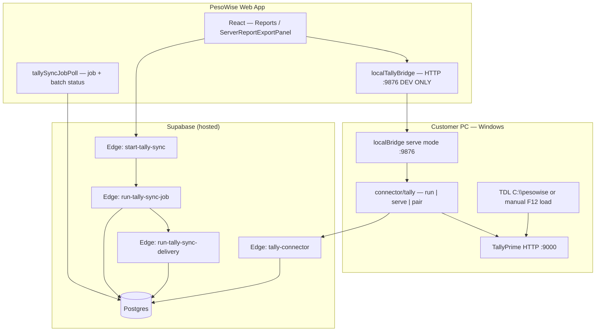
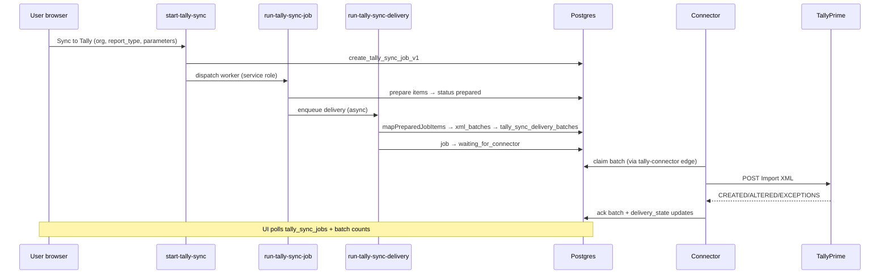

# Current Architecture (As-Built)

## System context

## Sync flow (sequence)

## Data model (core tables)

| Table | Role |
|-------|------|
| `tally_sync_jobs` | Job lifecycle: queued → processing → prepared → waiting_for_connector → delivering → completed/failed |
| `tally_sync_job_items` | Normalized prepared rows (JSON payloads) |
| `tally_sync_delivery_batches` | XML envelopes, status, lease, ack_summary |
| `tally_delivery_state` | Idempotency per delivery key (skip/create/update) |
| `tally_connector_devices` | Paired devices (token hash, org, installation_id) |
| `tally_connector_pairing_codes` | Short-lived pairing codes (admin-created) |
| `tally_org_connector_config` | Org Tally company name (server-side) |

## XML / mapping flow

1. **Preparation** (`run-tally-sync-job`): report-specific RPCs/pages → `PreparedJobItem[]`
2. **Mapping** (`src/lib/tallyMapping/` mirrored to `supabase/functions/_shared/tallyMapping/`):
   - Daily Project → **report_metadata** ledgers under group **PesoWise Metadata**
   - UDFs: `PESOWISE_DPR_*`, `PESOWISE_REPORT_TYPE`, `PESOWISE_REPORT_FLAT_ROW`, `PESOWISE_METADATA_JSON`
3. **Serialization** (`xml/serialize.ts`): `wrapEnvelope` + `SVCURRENTCOMPANY` placeholder → injected at delivery
4. **Batching** (`enqueueDeliveryBatches.ts`): chunking for large jobs; `tally_force_refresh` in job parameters

## Connector flow (two delivery paths)

| Mode | Entry | Delivery logic | Used when |
|------|--------|----------------|-----------|
| **`serve`** | `main.js serve` | `localBridge` + **`runServiceLoop`** (generic claim → `postXml`) | Vite dev auto-start |
| **Bridge deliver-job** | POST `/v1/deliver-job` | **`deliverEntireJob`** → **`deliverBoundBatch`** (verified split, duplicate→Alter) | Browser poll nudges in dev |
| **`run`** | `main.js run` | **`runServiceLoop`** only | Intended production background agent |

**Important:** `serviceLoop.ts` and `deliverBatch.ts` are **not identical** (production gap — see Phase 1 report).

## TDL flow

| File | Purpose |
|------|---------|
| `tally-extension/PesoWise-Bootstrap.tdl` | UDF slot declarations |
| `tally-extension/PesoWise-Load.tdl` | Includes full `PesoWise-Reports.tdl` |
| `tally-extension/PesoWise-Reports.tdl` | Menu + collections + report layouts |
| `tally-extension/PesoWise-Reports-SafeMenu.tdl` | **Recovery shell only** — empty placeholder reports |
| `tdl/03-collections.tdl` | `PW DPR Latest` — Child Of **PesoWise Metadata**, filter `PWFiltDPRTrack` |

Customer must load TDL in Tally (F12) unless installer copies to `C:\pesowise` and customer reloads TDL.

## Local bridge flow (development)

- **Port:** `127.0.0.1:9876`
- **Started by:** `vite.config.ts` → `tallyConnectorDevPlugin` → `node dist/main.js serve`
- **Endpoints:** `/v1/health`, `/v1/config`, `/v1/deliver-job`
- **CORS:** localhost dev origins only
- **Not suitable for production** (browser-dependent nudge, tied to `npm run dev`)

## Device authentication flow

1. Admin creates pairing code (RPC / admin tooling — see `tally_connector_pairing_codes`)
2. Connector CLI: `pair --url <supabase> --anon-key <key> --code <CODE>`
3. RPC `exchange_tally_connector_pairing_v1` → `device_token` (shown once)
4. Stored in `%USERPROFILE%\PesoWise\TallyConnector\config.json`
5. All connector calls: `X-Connector-Token` → Edge `tally-connector` → `resolve_tally_connector_device_v1`
6. Revocation: `revoked_at` / `is_enabled` on device row → heartbeat/claim returns 403

## Runtime dependencies

| Component | Dev | Production target |
|-----------|-----|-------------------|
| Node.js | Required (Vite, scripts) | **Not** required on customer PC (pkg EXE) |
| npm / Vite | `npm.cmd run dev` | **Not** required |
| TallyPrime | Yes, port 9000 | Yes |
| TDL files | Manual / copy to `C:\pesowise` | Installer |
| Supabase project | Backup host + Edge deploy | Same |
| SSH/Coolify scripts | Operator deploy (`deploy-e2e-controlled-stack.mjs`) | CI/CD TBD |

## Key file index

| Path | Role |
|------|------|
| `src/components/ServerReportExportPanel.tsx` | Generate report, Sync, poll, bridge health |
| `src/lib/tallySyncJobs.ts` | `startTallySync` → Edge |
| `src/lib/tallySyncJobPoll.ts` | Status messages, delivery complete detection |
| `src/lib/tallySyncParameters.ts` | Frozen sync context + `tally_force_refresh` |
| `src/lib/localTallyBridge.ts` | Dev bridge client |
| `supabase/functions/start-tally-sync/index.ts` | Enqueue + dispatch worker |
| `supabase/functions/run-tally-sync-job/index.ts` | Dataset preparation |
| `supabase/functions/run-tally-sync-delivery/index.ts` | Enqueue batches |
| `supabase/functions/tally-connector/index.ts` | heartbeat, claim, ack |
| `connector/tally/src/main.ts` | CLI commands |
| `connector/tally/src/serviceLoop.ts` | Background poll loop |
| `connector/tally/src/deliverBatch.ts` | Production-grade batch POST |
| `connector/tally/src/localBridge.ts` | Dev HTTP bridge |
| `scripts/tally-integration/*` | Deploy, diagnose, backfill ops |

## Related docs

- `docs/tally-integration/FINAL-PRODUCTION-ARCHITECTURE.md` (locked 2026-10-06)
- `docs/tally-integration/PHASE-05-CONNECTOR-TRANSPORT.md`
- `docs/tally-integration/AGENT-PAIRING-AND-SECURITY.md`
