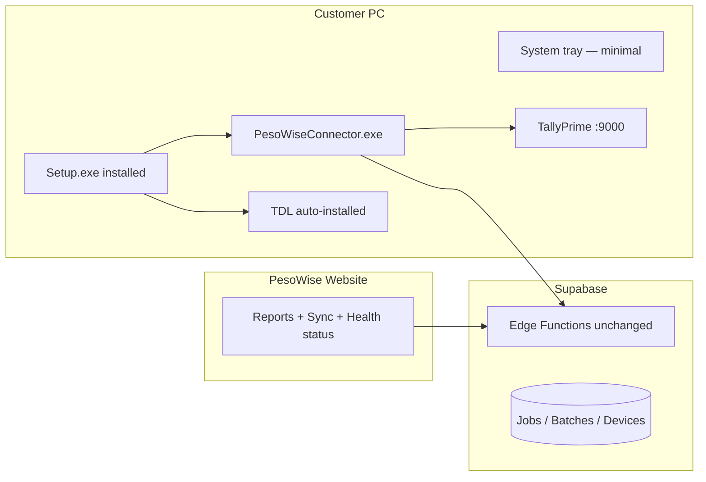

# Target Production Architecture (Summary)

> Detailed design evolves in Phases 4–9. This document is the north star; implementation is incremental.

## Target context

## Migration path (from current)

| Step | Phase | Outcome |
|------|-------|---------|
| Unify delivery logic | 3–4 | Single code path: `deliverBoundBatch` in `run` loop |
| EXE + logging + reconnect | 4 | No Node/npm on customer PC |
| Pairing wizard | 5 | Website or setup → code → config.json |
| Server-side job state only | 6 | Browser close irrelevant |
| Scheduled task / tray | 7 | Auto-start, resume pending |
| Health API + UI | 8 | Connector/Tally/last sync |
| Setup.exe | 9 | TDL + Agent + startup |

## Non-goals

- Electron desktop app
- Moving report workflows off the website
- Replacing Supabase or batch queue model

## References

- `docs/tally-integration/UNIVERSAL-INSTALLER-DESIGN.md`
- `docs/tally-integration/FINAL-PRODUCTION-ARCHITECTURE.md`
