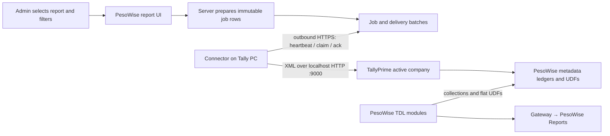

# PesoWise → TallyPrime: End-to-End System Guide

**Purpose:** a single handoff document for operators, support staff, and engineers. It describes the implemented design, the current setup and run steps, the work completed, known gaps, and a practical blueprint for reproducing the integration in another deployment.

**Last reviewed:** 13 October 2026  
**Scope:** the four PesoWise report exports delivered to TallyPrime as PesoWise metadata ledgers and displayed through the PesoWise TDL reports. This is not a general-purpose accounting voucher integration.

> **Status honesty:** the repository has the four report pipelines, connector, TDL modules, installer bundle, and automated checks. Live evidence covers some real imports and data read-back. The latest four-report visual layout is not yet confirmed on a freshly restarted Tally screen. Do not interpret “implemented” or a successful import response as proof that every report renders correctly in the customer's running Tally process.

## 1. What the system does

An administrator selects one of four reports in PesoWise, applies its filters, and clicks **Sync to Tally**. The server freezes the report rows into a job. The PesoWise connector on the Tally PC receives that specific job, checks the organization and company, then sends XML to the Tally HTTP service on the same PC. Tally stores one non-accounting metadata ledger per report row. The PesoWise TDL files provide four readable list views over those ledgers.

The application and Tally can be on separate networks. The connector PC needs internet access to the PesoWise backend and local access to its own TallyPrime instance. Tally's port is not exposed publicly by this design.

## 2. The four reports

| PesoWise report | Tally view | Row meaning / typical contents |
|---|---|---|
| Claim Verification List | Claim Verification List (PesoWise) | Claims and workflow state used for verification; includes employee, claim, destination, category, dates, amounts, approval and project/form values where available. |
| Claim Approval List | Claim Approval List (PesoWise) | Approved claims and their claim/approval fields. The server report’s approved status and selected filters are captured in the job. |
| Detailed Expense Report | Detailed Expense Report (PesoWise) | Approved expense and balance-timeline rows, including expense/deduction/credit events and balance context. It is not necessarily one row per claim. |
| Daily Project Report | Daily Project Report (PesoWise) | One row per employee, date, and project grouping as prepared by the server; includes project, employee, location, attendance/remarks and cost fields. Missing project details may be flagged/reviewed in the PesoWise source report. |

The exact row set is defined by the selected report, filters, and server-side report implementation at job preparation time. A later UI filter change does not rewrite an existing job. Generate/export and Tally sync are separate actions; an exported CSV does not mean Tally received it.

## 3. Components and responsibilities

| Component | Repository location | Responsibility |
|---|---|---|
| Reports page | `src/pages/Reports.tsx` | Report selection, filters, CSV/export actions, sync controls, status. |
| Report export Edge Function | `supabase/functions/run-report-export-job/` | Server-side report generation/export, paging, history and snapshots as applicable. |
| Tally job preparation | `supabase/functions/run-tally-sync-job/` | Build a job for one selected report, normalize/map its rows and prepare delivery batches. |
| Shared report types and mapper | `supabase/functions/_shared/tallyReportTypes.ts`, `supabase/functions/_shared/tallyMapping/` | Defines accepted report types and the normalized Tally row/UDF representation. |
| Database schema and RPCs | `supabase/migrations/` | Connector pairing, report jobs/items, batches, leases, acknowledgements, history and access controls. Review migrations before deploying; do not copy only application code. |
| Connector | `connector/tally/src/` | Pairing, background polling/heartbeat, explicit job delivery, local bridge, Tally company/port preflight, XML exchange and acknowledgements. |
| TDL source | `tally-extension/tdl/` | Menu, shared styles/collections, and four report screens. |
| Customer bundle | `installer/out/`, generated by `scripts/tally-integration/build-customer-bundle.mjs` | Packaged connector, TDL files, README and Windows installer script. |
| Tally layout checks | `src/lib/__tests__/tallyMetadataE2EPreflight.test.ts` and related Tally tests | Contract checks for source/bundle layout and metadata mapping. These do not replace a live Tally visual check. |

Important references: [E2E production runbook](./E2E-PRODUCTION-RUNBOOK.md), [final architecture](./tally-integration/FINAL-PRODUCTION-ARCHITECTURE.md), [TDL read model contract](./tally-integration/TALLY-TDL-READ-MODEL-CONTRACT.md), [pairing and security](./tally-integration/AGENT-PAIRING-AND-SECURITY.md), [connector preflight](./tally-integration/AGENT-PREFLIGHT.md), and [installer README](../installer/README.md). Some older phase documents describe earlier, narrower product states; this guide and the current source/bundle take precedence for current component scope.

## 4. Full sync lifecycle (0 to 100)

### 4.1 Prepare the report

1. An authorized PesoWise admin opens **Reports** and chooses one report.
2. The admin selects report-specific filters (date/period, employee, category, approval state, project/custom fields, etc.).
3. PesoWise builds or displays the server report. The export worker handles full server-side result sets; it does not depend on the browser rendering every row.
4. On **Sync to Tally**, the backend validates the report type and organization, prepares a job-specific immutable row snapshot and creates delivery batches. A sync job is not a generic “send every pending batch” command.
5. Job identity and report type remain attached to the prepared rows. The connector is expected to deliver only batches belonging to the explicitly requested job. Do not manually replay historic pending or uncertain jobs as a layout test.

### 4.2 Deliver to Tally

6. The connector running on the designated Tally PC checks in with PesoWise using outbound HTTPS. Its device token is scoped to its paired organization/device and can be revoked.
7. When a report sync is requested, the connector handles the associated job/batches. Its local bridge verifies that Tally's HTTP/XML endpoint is reachable on `127.0.0.1:9000`, the configured company is open, and the server-paired organization/company match the local active Tally company.
8. If preflight passes, the connector submits XML to that local Tally instance. The company directive is set to the configured company. A company mismatch or unavailable Tally must not be reported as a successful import.
9. Tally imports metadata ledger masters and their flat UDF fields. The expected report payload is kept as data for reporting; the integration does not make a voucher or post a debit/credit to accounting books.
10. The connector reads the import response and acknowledges the batch. The backend updates delivery state and aggregate job counts. A successful XML response by itself is weaker evidence than persisted-row read-back.
11. Once batches are acknowledged, the job reaches its terminal status (normally completed). PesoWise displays progress/counts and the CSV remains separately downloadable.

### 4.3 Display in Tally

12. The TDL collection filters ledgers by the relevant `PESOWISE_REPORT_TYPE` and the report’s stable metadata keys. The reports are available from **Gateway → PesoWise Reports** (menu naming may vary slightly with the loaded menu module).
13. The current TDL display uses explicit flat UDFs for fields and a flat-row fallback where implemented. It does not rely on Tally parsing the full JSON value to render every cell; this avoids a known fragile path in wide report views.
14. The four TDL screens render their own columns, headings, repeated rows, and horizontal/vertical scrolling. A successful import does not automatically refresh an already-open Tally report screen or load a changed TDL from disk. Reload/restart Tally to activate changed TDLs, then reopen the view.

## 5. Data model, safety and duplicate behavior

### Metadata instead of vouchers

The Tally records are PesoWise report metadata ledgers under the PesoWise metadata grouping. They support a report view and drill-down. They are not accounting vouchers and do not, by themselves, alter account balances. Users requiring accounting postings need a separately designed and approved voucher workflow.

### Stable identity and updates

- Each logical row has a stable metadata delivery key (`K`) and a content hash (`H`).
- Unchanged content can be skipped idempotently rather than imported repeatedly.
- Changed content is represented by a new immutable ledger version (append-only CREATE). The current logical version is selected by the highest metadata revision for the same key.
- Production delivery intentionally avoids HTTP/Tally **ALTER** for these metadata rows. Real Tally testing found CREATE and repeat SKIP behavior; ALTER was unreliable. Append-only versions preserve old data and avoid depending on fragile in-place update semantics.

### Guardrails

- Pairing binds the PesoWise organization, connector device, and configured Tally company.
- Device tokens are local credentials and revocable. Do not put user passwords, admin JWTs, service-role keys, or secrets into the connector config or TDL.
- Connector delivery is explicit-job scoped; startup must not sweep historical batches indiscriminately.
- If an import result is ambiguous (for example, the connector loses the response after Tally may have accepted XML), automatic blind retry can duplicate records. Such batches can enter an exception/manual-review safety state. This is a delivery integrity safeguard; it is not part of the normal successful route. Do not clear/retry that state without reconciling the target Tally company and records.
- Never use **Revoke**, delete connector config, truncate jobs, or replay old batches as a visual-formatting fix.

## 6. One-time customer setup

### What the customer needs

- A Windows PC where the target TallyPrime company is installed and can be opened.
- Network/internet access from that PC to the PesoWise application/backend.
- Local permission to install the connector and configure Tally’s local HTTP/XML interface.
- Admin access in the correct PesoWise organization to pair a connector and set the organization’s exact Tally company name.
- The target company must be open in Tally while delivery is being performed.

### First-time steps

1. **Choose the Tally PC.** Use the same Windows PC where the target company is opened in TallyPrime. Keep it on the network that can reach PesoWise. No inbound internet exposure of Tally is needed.
2. **Set the company name in PesoWise.** In PesoWise Admin → **Tally integration**, save the exact TallyPrime company name. The name must match the company that will be open locally.
3. **Install the connector and TDL package.** Use the supplied customer package. The current bundle contains `PesoWiseSync.exe`, `Install-PesoWise-Tally.ps1`, the hidden launcher, TDL files, and README. The PowerShell installer copies the connector to `%ProgramFiles%\PesoWise\TallyConnector` and TDL files to `C:\pesowise`; by default it registers a hidden Windows Scheduled Task named `PesoWiseConnector` to start at user logon. Installing/registering the task may require Windows administrator rights. A single polished installer EXE is optional packaging; the repository documents the PowerShell bundle as the internal rollout path, so confirm which actual release artifact was handed to the customer.
4. **Pair once.** Start `PesoWiseSync.exe` (or the setup shortcut, if the Inno Setup wrapper is used). On an unpaired installation the setup flow opens a browser. In PesoWise Admin → **Tally integration**, create/show the pairing code and enter it in the setup flow. Confirm the exact Tally company. Pairing exchanges the short-lived code for a revocable device token and stores the connector config locally. Do not send the code/token to support in screenshots or chat.
5. **Load TDL files once in Tally.** In TallyPrime’s local TDL/add-on configuration, load the supplied `PesoWise-Bootstrap.tdl` and `PesoWise-Load.tdl` from `C:\pesowise`. The Load file includes the report manifest/modules; do not also enable included child modules separately if that creates duplicate definitions. Save and fully exit/reopen TallyPrime so the TDL definitions are actually loaded.
6. **Enable local HTTP/XML.** In TallyPrime, enable the local HTTP/XML server on port `9000` (the supplied quick README says F1, depending on the Tally screen/version). Confirm Tally is listening locally and the intended company is open. Do not open port 9000 to the public internet.
7. **Confirm readiness.** In PesoWise Admin → **Tally integration**, verify connector heartbeat/“This PC connected” state. On the PC, the connector can run its bundled diagnostic if support requests it; it checks the backend connection, local Tally reachability and company configuration. A green cloud heartbeat alone does not prove local company verification or a successful import.
8. **Initial test.** Use a small, known report in the intended test company. Click Sync once and wait for the job status. Check the expected report menu and verify records in Tally. Do not start with thousands of rows until company and TDL display are confirmed.

The connector config is stored under `%USERPROFILE%\PesoWise\TallyConnector\config.json` and contains the device token, organization ID, connector ID, Tally company name, PesoWise API URL, and config version. Treat this file as secret because the device token can authorize connector operations. Pairing should not require the employee’s PesoWise password or admin JWT to be stored on the PC.

## 7. What happens on every later sync

After setup is complete, the user does **not** pair again or manually load TDLs for each report.

1. Start/sign in to Windows on the Tally PC; the installed logon task starts the hidden connector, if that task was installed and enabled.
2. Open TallyPrime and the correct company. Leave its local HTTP/XML interface available on port 9000.
3. Confirm the connector is online in PesoWise Admin → Tally integration if the sync is important or the status looks stale.
4. In PesoWise Reports, choose the report and filters, then click **Sync to Tally** once.
5. Keep the PC, TallyPrime, network, and connector running until the job finishes. Check job progress/status in the PesoWise UI and open the corresponding **Gateway → PesoWise Reports** view in Tally.

**It will not sync while the PC is off, Tally is closed/unreachable, the connector is stopped, or the PC cannot reach the backend.** The connector is a local bridge, not a cloud Tally server. The logon task helps start it after Windows sign-in; it does not make Tally available when the computer is powered off or logged out. Some locked-down Windows policies may block scheduled tasks or background startup; the customer’s IT admin must allow the supplied task/connector.

## 8. Current installation and support locations

| Item | Current documented location |
|---|---|
| Customer package source (build output) | `installer/out/` |
| Installed connector | `%ProgramFiles%\PesoWise\TallyConnector\PesoWiseSync.exe` (default installer path) |
| Scheduled task | Windows Task Scheduler → `PesoWiseConnector` |
| Pairing config | `%USERPROFILE%\PesoWise\TallyConnector\config.json` |
| Installed TDL root | `C:\pesowise` |
| TDL module directory | `C:\pesowise\tdl` |
| Connector logs | Use connector’s configured/log output path and the bundled support diagnostic; verify exact release path before giving customer-specific log instructions. |
| Tally local HTTP/XML endpoint | `127.0.0.1:9000` on the Tally PC only |

The exact released installer can have a different version or path. Use the release README that ships with that same package; do not assume an old EXE in the repository is safe for distribution just because source files build.

## 9. Issues investigated and what was fixed

This section records the causes behind the repeated empty/illegible report symptoms. It separates fixes present in source/on disk from fixes proven in the live Tally screen.

### A. Rows imported but a report view was empty

**Why it happened:** the Tally masters could be present while the TDL collection did not select them, or the screen was still using an old TDL definition. One historical Daily Project investigation found persisted records with the correct report type/date but the view’s collection filter and formula identifiers did not reliably match the Tally definitions. Some old screens also did not refresh after new rows arrived.

**Work done:** collection predicates and formula identifiers were corrected; the report-type discriminator and flat row fields were aligned with the metadata shape. Claim Verification’s fallback/refresh behavior was also investigated and updated on disk. These changes require loading the matching TDL in the running Tally process. Earlier observations must not be treated as proof that a later TDL is active.

### B. Import response said created, but user expected real accounting entries

**Why it happened:** this integration creates report metadata ledgers, not vouchers. Tally may show these in a custom PesoWise report rather than standard accounting registers. “Created” means Tally accepted metadata masters, not that an accounting voucher was posted.

**Work done:** metadata row identity, report type, field UDFs, collection filters and custom report views were defined. The distinction is intentional and must be communicated to users. Voucher posting is outside this integration’s behavior.

### C. Columns ran together, rows looked cramped, and horizontal scroll seemed wrong

**Why it happened:** each report assigned a percentage of the screen independently to many columns. With 19 or 23 columns, percentages compounded unpredictably inside the scrolling grid and left values crowded together. Text wrapping alone could not fix that. Tally also continues using the TDL definition already loaded into memory until that definition is reloaded.

**Work done:** the four source lists use fixed character widths for every header and matching data field. Each now has one full-screen part containing both the heading and repeated data lines, with `Scroll : Both`, so the header and rows move together instead of being laid out in separately constrained nested parts. List text is larger, numeric columns remain right-aligned, and the header has a separating rule. The outer report form remains `100% Screen`. Tally squeezes child fields when a containing part or form cannot fit them; its documentation recommends a repeated part with `Scroll : Both` for wide lists ([dimensions and formatting](https://help.tallysolutions.com/what-is-dimensions-and-formatting-in-tdl/), [wide reports FAQ](https://help.tallysolutions.com/article/DeveloperReference/faq/6555.html)). Repository, connector bundle, installer bundle, and active installed modules are synchronized. No field mapping, stored ledger, or sync behavior was changed.

**Verification limit:** the focused TDL contract test checks all four field-width sets, unified heading/data scroll parts, text styles, full-screen viewport, and column mappings. Source, connector bundle, installer bundle, and active installed-file copies must match. The current screenshot still shows the cramped earlier layout, so visually confirm the unified `Scroll : Both` version after Tally reloads the on-disk TDL. Do not replay a sync to test a display-only change.

### D. Daily Project and detailed report fields did not line up with stored data

**Why it happened:** reports were wide and the original screen depended on field bindings/filter assumptions that had not been proven against the stored Tally metadata. A visual list may be blank even when Tally has the ledger rows.

**Work done:** the runbook records read-only checks that found stored Daily Project records and matched selected source totals, and separate investigation of the Detailed Expense blank grid. Flat UDFs/fallbacks were introduced for display and formula/collection contracts were tightened. A stored-ledger query or clean import response is only data-layer proof; the report still requires an activated TDL and visual check.

### E. Retry risk after an uncertain response

**Why it happened:** Tally may have accepted an XML import even if the connector/backend did not receive a clean response. Blind retry could duplicate metadata or obscure what already imported.

**Work done:** batch/job state and explicit acknowledgment paths were designed; stable keys/content hashes support unchanged-row SKIP and append-only revisions; uncertain results are guarded instead of silently replayed. A manual-review/exception state remains a safety fallback. Removing its visible UI would not remove the underlying ambiguity or make automatic retries safe.

### F. Development test versus a real end-to-end test

**Why it happened:** unit tests, a green heartbeat, one XML response, and an open Tally report each prove different parts of the path. They do not establish that every report’s exact rows persisted and rendered in the live company.

**Work done:** the production runbook tracks separate evidence for XML delivery, persisted ledgers/UDFs, report collection counts, and visual rendering. The Daily Project had a documented real metadata import/readback in an isolated test company. All four TDLs have static/automated contract checks. Each report’s freshly loaded live screen still needs visual acceptance before claiming all four are fully verified.

## 10. Current status ledger

| Area | Current evidence/status |
|---|---|
| Four report types in UI and server sync pipeline | Present in repository; report-specific wiring and mapper paths exist. |
| Server-side report generation/export | Present, including server pagination/report job paths. Exact deployment migration state must be checked for each target backend. |
| Connector pairing and company identity | Implemented in connector/backend design; admin UI exposes connector state. Pair only the intended PC and exact company. |
| Local Tally transport | Connector uses local Tally endpoint `127.0.0.1:9000`; it needs the PC and Tally to be available. |
| Metadata import/idempotency | Real CREATE/SKIP and append-only strategy are documented/tested; do not infer voucher posting. |
| Daily Project persisted data | Runbook includes a real isolated test-company import and row/field read-back. Historical tests do not automatically validate the latest TDL package. |
| Claim Verification / Claim Approval / Detailed Expense live import and readback | Do not assume live pass from automated tests; verify the exact job in the target test company. |
| TDL layout contracts | Four list screens and width/scroll checks exist; focused test passed 12/12 in the recorded pass. |
| Current visual readability after final width fix | **Pending** a full Tally reload/restart and fresh visual review of all four screens. |
| Fully automatic one-click completion | Connector/background path exists, but runbook evidence includes earlier deliveries performed via CLI and explicitly says that one-click browser-to-completion was not demonstrated in that test. Re-verify the currently released connector build before promising this to customers. |
| Installer experience | Customer bundle includes EXE, TDL, PowerShell install script, and scheduled-task registration. Optional Inno Setup wrapper is defined; confirm whether it was built and included in the customer release. |
| Manual review/uncertain import handling | Safety logic remains. It can be reached for uncertain/error cases; it is not safe to remove retry protections just to make the happy path look fully automatic. |

## 11. Troubleshooting guide

| Symptom | Likely cause | Safe checks / next action |
|---|---|---|
| Connector says offline | Windows task/connector not running, network unavailable, stale/revoked pairing | Start the installed connector from the Tally PC; check Windows Task Scheduler task `PesoWiseConnector`; check admin connector heartbeat. Re-pair only if revoked or config is genuinely lost. |
| Connector online but sync waits | Tally closed, port 9000 unavailable, wrong company open, network interruption, or no batch acknowledged | Open the target company; check local Tally HTTP/XML on 9000; verify exact company name; inspect that job’s status. Keep connector running. Do not repeatedly click Sync for the same stuck job. |
| Company verification fails | Organization/company pairing mismatch or wrong active Tally company | Stop that delivery attempt; open the intended company and correct server-side company config. Do not bypass preflight. |
| Job says completed but no visible report | Wrong Tally menu/report type filter, TDL not loaded/reloaded, report screen not refreshed, or view/render issue | Verify company, menu, report type, TDL file/version and last import/readback. Reload/restart Tally and reopen view. No re-sync should be needed if records are already persisted. |
| Headers/data overlap or columns appear narrow | Old TDL loaded, wrong TDL module duplicated/disabled, or width interpretation/version mismatch | Confirm Bootstrap + Load configuration, ensure included modules are not also enabled independently, fully exit/reopen Tally, then inspect all four screens and use horizontal scroll. Keep a screenshot and TDL hashes for support. |
| Report is genuinely empty | Filters generated no rows, report status excludes source data, collection filter mismatch, or Tally rows absent | Check PesoWise generated CSV row count and filters, job’s prepared/delivered counts, and read-only Tally row count for that job/type. Separate source-empty from import-empty from TDL-display-empty. |
| Manual review / uncertain batch appears | Tally may have imported but response/readback is ambiguous, or import returned an unsafe response | Reconcile against the configured Tally company and job identifiers before acknowledging or authorizing a retry. This state blocks automatic duplicate risk. Never authorize retry solely to clear the screen. |
| Duplicate/older row appears after changed data | Append-only revision model retains old physical versions; view must select current revision per stable key | Confirm the current logical row selection uses metadata revision, not string-sorted content hash. Do not delete historical metadata ledgers as a first fix. |

Useful support artifacts: report/job ID, report type, selected row count, connector version, Tally version, active company, connector heartbeat, Tally HTTP status, installed TDL hashes, screenshot after restart, and read-only Tally counts. Redact pairing codes, device tokens, passwords and any personal/financial data not needed to diagnose.

## 12. Reimplementation blueprint for another environment

Use this as a design and deployment checklist, not as a script to run blindly.

### Backend and data layer

1. Port the four server report contracts and ensure their organization authorization and filters match PesoWise policy.
2. Apply and verify all required database migrations in order, including grants/RLS, pairing, job/item/batch state, lease/ack RPCs, report history/snapshots and indexes. Verify the target database’s migration history; do not assume files in Git were applied remotely.
3. Implement a job snapshot so later source edits or UI changes do not silently mutate a prepared job.
4. Scope every job, row and batch to the organization and one of the four report types. Enforce server-side authorization rather than trusting browser input.
5. Implement stable metadata delivery keys, content hashes, revision numbers, immutable append-only writes and idempotent skip semantics.
6. Restrict the connector to its paired organization/device and only the intended job. Implement expiring claims/leases, ack/failure states and conservative ambiguous-import handling.
7. Add operational monitoring that separates queued, claimed, imported, acknowledged, failed and uncertain counts.

### Connector and local bridge

8. Package a Windows connector that pairs through a short-lived code and stores only the revocable device token plus organization/device/company configuration.
9. Connector communicates outbound to the backend; only the local bridge talks to `127.0.0.1:9000`. Do not expose Tally's XML port externally.
10. Before each import, verify backend pairing, requested company and locally active Tally company. Stop on mismatch/unavailability.
11. Do not auto-drain old pending batches at process startup. Link delivery to a user-initiated job and make that boundary observable.
12. Package predictable startup (signed installer as appropriate, least privilege, logon startup task, uninstall/upgrade path), update/version reporting, logs and diagnostics. Test Windows Defender/IT policy and Tally versions.

### Tally metadata and TDL

13. Define stable UDF IDs and schemas for report type, delivery key, content hash, revision, sync run, and every field rendered in each report. Keep a versioned schema contract.
14. Import a metadata master, not accounting vouchers, unless voucher posting is explicitly designed as a separate product scope.
15. Build one TDL collection and report view per report type. Match collection filters to persisted UDF values. Declare fetched UDFs before filters that evaluate them.
16. Use flat UDFs for visible cells; treat large JSON fields as audit/debug data, not the primary cell source. Verify identifiers/formulas have exact consistent spelling.
17. Define a viewport and consistent heading/body column widths, valid TDL screen-relative syntax, wrap/row-height rules, and both scroll directions. Check every source, customer-bundle, installed, and runtime copy.
18. Keep the TDL modules modular and load them once through a manifest. Avoid enabling the same included module twice.

### Release and acceptance

19. Build the app, Edge Functions, DB migration package, connector and TDL from one pinned release commit. Generate an artifact manifest with versions and hashes.
20. Deploy migrations/functions to a named test environment and verify health, RLS/grants, organization pairing and rollback plan before customer rollout.
21. Use an isolated Tally test company and synthetic rows. For each report, compare source snapshot count/totals with imported persisted ledger count/fields and the visible TDL screen.
22. Verify first import, unchanged repeat (skip), changed-row append-only revision, wrong-company rejection, Tally offline behavior, connector restart behavior, and ambiguous-response protection.
23. Test screen readability at the customer's Tally version, Windows display scaling and window size. Verify headings and row cells line up, horizontal scrolling moves through all columns, vertical scrolling shows rows, and reopening after sync refreshes data.
24. Release only after four separate end-to-end report sign-offs. Attach the customer setup guide and troubleshooting details to the exact released package.

## 13. Acceptance checklist (all four reports)

- [ ] Correct organization and exact Tally company are paired.
- [ ] Connector runs on the same PC as Tally and can reach PesoWise over HTTPS.
- [ ] Tally company is open and local HTTP/XML on port 9000 is available only locally.
- [ ] Both intended TDL entry files are enabled; included child modules are not duplicated.
- [ ] A small controlled report creates a fresh, report-specific job.
- [ ] Prepared row count and sample field values match the PesoWise CSV/snapshot.
- [ ] Connector claims only that job, imports XML, and acknowledges its batches.
- [ ] Read-only Tally inspection confirms correct report type, delivery key, revision and field values.
- [ ] Unchanged second sync skips unchanged logical rows; a changed row creates a new revision without ALTER.
- [ ] Tally view shows the expected rows and values, with readable spacing and aligned headings.
- [ ] Horizontal scroll reaches every column; vertical scroll reaches all rows.
- [ ] Repeat the previous checks independently for Claim Verification, Claim Approval, Detailed Expense and Daily Project.
- [ ] Record Tally version, connector/TDL versions, counts, totals, screenshots and pass/fail evidence.

## 14. Short customer handout

**One-time:** install the PesoWise connector on the Tally PC → pair it once in PesoWise Admin → load the PesoWise TDL files in Tally and restart Tally → enable local port 9000 → open the correct Tally company.

**Each sync:** make sure the Tally PC and connector are on, Tally has the correct company open, then select the report in PesoWise and click **Sync to Tally**. Keep Tally/connector running until PesoWise reports completion. Open **Gateway → PesoWise Reports** in Tally to view it.

If the Tally PC is off, Tally is closed, its local service is unavailable, or the connector is offline, the report cannot arrive at that moment. Reconnect the PC/Tally/connector and check the existing job status before creating another sync.

---

**Document maintenance:** update this guide when report filters, database/RPC contracts, UDF IDs, TDL menu/report names, connector startup behavior, package layout or live acceptance evidence changes. Mark any unverified live behavior as pending instead of promoting a unit-test pass to a production claim.
