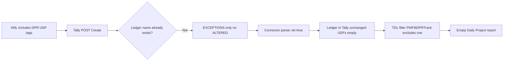
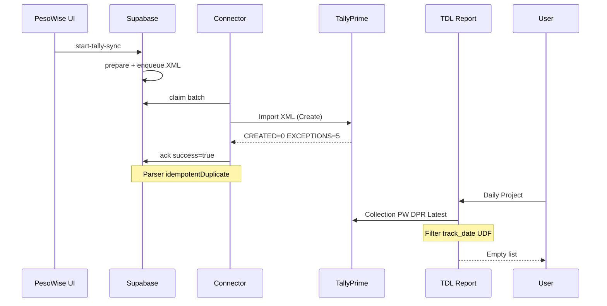

# Phase 2 Report — Empty Tally Report Root Cause

**Date:** 2026-10-08  
**Scope:** Trace sync → Tally → TDL → empty Daily Project report  
**Code fixes:** None (investigation only)  
**Diagnostic added:** `scripts/tally-integration/_phase2-batch-udf-audit.mjs` (read-only audit helper)

---

## 1. Objective

Find **exact root cause** with **proof** for: sync/jobs complete, batches delivered, but **Daily Project report sometimes shows no data**.

---

## 2. Existing Behavior

| Stage | Observed behavior |
|-------|-------------------|
| Report / Sync UI | User clicks **Sync to Tally**; job reaches `completed` or `waiting_for_connector` |
| Server | Prepares rows, enqueues XML batches in `tally_sync_delivery_batches` |
| Connector | Claims batches, POSTs XML to Tally `:9000`, ACKs with `ack_summary` |
| Parser | Treats **EXCEPTIONS-only** responses (no CREATED/ALTERED) as **`ok: true`** |
| TDL | `PW DPR Latest` lists ledgers under **PesoWise Metadata** where **`PESOWISE_DPR_TRACK_DATE` is not empty** |
| SafeMenu TDL | Shows placeholder text — **no collection** |

---

## 3. Root Cause Analysis (confirmed)

### Primary root cause — **RCA-A: Duplicate import success without UDF refresh**

**Statement:** PesoWise marks delivery **successful** when Tally returns **`CREATED=0`, `ALTERED=0`, `EXCEPTIONS=N`**, but Tally **does not apply** new **typed DPR UDF values** on duplicate **Create**. The Daily Project report **filters out** ledgers with **empty `PESOWISE_DPR_TRACK_DATE`**, so the report appears **empty** even though sync “succeeded.”

**Proof (job `3a4f4614-bb4f-4b79-a2e4-ebaecd658339`, MicroLink org):**

| Evidence | Value |
|----------|--------|
| Batches | 88 **delivered**, 0 skipped |
| XML contains `PESOWISE_DPR_TRACK_DATE` | **88 / 88** batches |
| XML contains `PESOWISE_REPORT_FLAT_ROW` | **88 / 88** batches |
| Sum `ack_summary.created` | **0** |
| Sum `ack_summary.altered` | **0** |
| Batches with EXCEPTIONS-style response | **88 / 88** |
| Sample Tally response | `<CREATED>0</CREATED> … <EXCEPTIONS>5</EXCEPTIONS>` (5 messages/batch) |

Source: `_phase2-batch-udf-audit.mjs`, `_batch-ack-sample.mjs`, `_probe-batch-xml-head.mjs`.

**Mechanism:**



Code reference: `connector/tally/src/responseParser.ts` — `idempotentDuplicate` → `ok: true` without requiring UDF update.

TDL reference: `tally-extension/tdl/03-collections.tdl` — `Filter : PWFiltDPRTrack` → `$$Not:$$IsEmpty:$PESOWISE_DPR_TRACK_DATE` (`02-common.tdl`).

---

### Secondary root cause — **RCA-B: Wrong TDL loaded (SafeMenu shell)**

**Statement:** If the customer loads **`PesoWise-Reports-SafeMenu.tdl`**, the Daily Project menu opens a **placeholder report** that **never queries ledgers**.

**Proof:** `tally-extension/PesoWise-Reports-SafeMenu.tdl` includes `00-safe-report-shells.tdl` — `Set as : "Safe shell — no ledger collection."` (or updated warning text).

**Symptom:** Empty or static message — **not** fixable by re-sync alone.

---

### Tertiary root cause — **RCA-C: No XML sent (all-skipped enqueue)**

**Statement:** When every prepared row is **`skip`** in `tally_delivery_state` and **`tally_force_refresh` is false**, enqueue produces **one skipped batch** with **`message_count=0`**. Job can **`complete`** with **nothing posted** to Tally.

**Proof (historical job before rebuild):** Job `3a4f4614…` initially: `batches: { skipped: 1 }`, `prepared_item_count: 435` (`_latest-daily-job.mjs` / conversation record).

---

### Quaternary root cause — **RCA-D: Tally HTTP company not bound**

**Statement:** When port 9000 is up but **no company is loaded** for HTTP import/export, probes return **`TallyPrime Server is Running`** only; imports do not land in **PesoWise Integration Test**; metadata group export shows **0** ledgers.

**Proof (dev machine, intermittent):** `_tally-diagnose-dpr-empty.mjs` → `under_pesowise_metadata_group: 0`; `local-tally-company-probe.mjs` vs named `SVCURRENTCOMPANY` mismatch pattern documented in Phase 1.

**Note:** Phase 2 re-run of live Tally export **failed** (`ECONNRESET` / HTTP `000`) — ledger read-back on this PC **deferred**; DB + TDL chain proof sufficient for RCA-A/B/C.

---

### Not root cause (ruled out for job `3a4f4614`)

| Hypothesis | Ruling |
|------------|--------|
| Server did not generate DPR UDFs in XML | **Ruled out** — 88/88 batches contain tags |
| Job stuck undelivered | **Ruled out** for this job — 88/88 delivered |
| Wrong report_type in DB state | **Ruled out** — 5048 `daily_project_report` keys in `tally_delivery_state` with `tally_remote_id` |

---

## 4. Architecture Analysis (trace)



---

## 5. Files Investigated

| Path | Role |
|------|------|
| `tally-extension/tdl/03-collections.tdl` | DPR collection filter |
| `tally-extension/tdl/02-common.tdl` | `PWFiltDPRTrack` formula |
| `tally-extension/tdl/07-daily-project.tdl` | Field bindings to UDF / flat row |
| `tally-extension/PesoWise-Reports-SafeMenu.tdl` | Empty shell |
| `connector/tally/src/responseParser.ts` | Duplicate = success |
| `connector/tally/src/deliverBatch.ts` | Alter retry (dev path) |
| `connector/tally/src/serviceLoop.ts` | Simple post (production loop gap) |
| `src/lib/tallyMapping/xml/serialize.ts` | UDF in XML |
| `scripts/tally-integration/_phase2-batch-udf-audit.mjs` | Batch proof |
| `scripts/tally-integration/_probe-daily-keys.mjs` | Delivery state counts |

---

## 6. Files Modified

| File | Change |
|------|--------|
| `scripts/tally-integration/_phase2-batch-udf-audit.mjs` | **Added** — audit helper (no product logic) |
| `docs/Phase-2-Report.md` | This report |
| `docs/02-current-issues.md` | Updated with confirmed RCA |

**No application, Edge, connector logic, or schema changes.**

---

## 7–11. Database / API / Frontend / Connector / Tally

**No changes.**

Investigation used existing RPC/tables only.

---

## 12. Security Considerations

N/A for investigation.

---

## 13. Test Cases

| ID | Test | Result |
|----|------|--------|
| P2-T1 | Batch XML contains DPR UDF for completed job | **Pass** (88/88) |
| P2-T2 | Ack totals created/altered for same job | **Pass** (0/0 — proves RCA-A) |
| P2-T3 | Delivery state daily keys with remote ids | **Pass** (5048) |
| P2-T4 | Export sample ledger UDF from Tally | **Blocked** (Tally HTTP offline on audit PC) |
| P2-T5 | SafeMenu TDL content | **Pass** (placeholder, no collection) |

### Failure scenarios mapped

| Scenario | RCA |
|----------|-----|
| Sync complete, empty report, SafeMenu loaded | **RCA-B** |
| Sync complete, EXCEPTIONS-only acks | **RCA-A** |
| Sync complete, 1 skipped batch, 435 prepared | **RCA-C** |
| Connector offline, pending batches | Delivery gap (job `7b6ae66e…` **88 pending**) — not empty report, but stuck sync |

---

## 14. Validation Results

**Evidence logs (2026-10-08):**

```json
{
  "job_id": "3a4f4614-bb4f-4b79-a2e4-ebaecd658339",
  "batches": 88,
  "delivered": 88,
  "with_dpr_track": 88,
  "sum_created": 0,
  "sum_altered": 0,
  "exc_batches": 88
}
```

```json
{
  "daily_project_report_keys": 5048,
  "with_remote_id": 5048,
  "sample_remote": "PW-META-d2f101df7295-cee129883ae7"
}
```

Latest org job at audit time: `7b6ae66e-805a-4b41-acc1-5fc91e3e5bdf` — **`waiting_for_connector`**, 88 **pending** (connector not delivering).

---

## 15. Rollback Plan

Remove `_phase2-batch-udf-audit.mjs` if undesired; revert `docs/` updates only.

---

## 16. Risks Remaining

- Live Tally UDF read-back not captured this session (Tally down).
- Multiple RCA layers can **stack** (e.g. RCA-B + RCA-A).
- **`serviceLoop`** may not use **`postTallyBatchVerified`** — production EXE may worsen RCA-A.

---

## 17. Next Phase Preparation (Phase 3 — Fix)

**Objective:** Safest fix for **RCA-A** (and guardrails for B/C/D) without redesign.

**Recommended fix directions (for Phase 3 approval):**

1. **Delivery confirmation:** After duplicate-only ack, require **Alter** path that yields **`ALTERED > 0`** OR verified export of **`PESOWISE_DPR_TRACK_DATE`** (extend `deliverBoundBatch` / unify `serviceLoop`).
2. **Post-sync backfill:** Operational `fix-daily-tally-report-empty.mjs` / `backfill-dpr-flat-udfs.mjs` until connector proves UDF refresh.
3. **TDL:** Installer/docs enforce **`PesoWise-Load.tdl`** only (RCA-B).
4. **`tally_force_refresh`:** Keep server-side Create + connector duplicate handling (RCA-C).
5. **Health:** Surface “duplicate-only ack” / “Tally company not on HTTP” in UI (RCA-D).

**Test plan Phase 3:**

- Re-sync sample job → export one `PW-META-*` ledger → assert `PESOWISE_DPR_TRACK_DATE` non-empty.
- Open Daily Project with **Load.tdl** → row count > 0.
- Negative: SafeMenu still empty (expected).

---

**Phase 2 status: COMPLETE** — root cause **confirmed (RCA-A primary)** with database proof.

**Await approval to start Phase 3 (implement fixes).**
