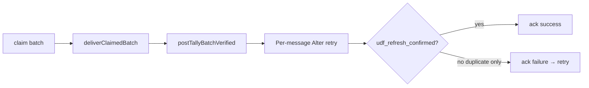

# Phase 3 Report — Fix Empty Report (RCA-A)

**Date:** 2026-10-08  
**Targets:** RCA-A (duplicate-only ack), RCA-B messaging, unified connector delivery

---

## 1. Objective

Implement the **safest fix** so Daily Project data can appear in Tally after sync: **do not treat duplicate-only Tally responses as successful delivery** unless **UDFs were refreshed** (`CREATED` or `ALTERED` > 0).

---

## 2. Existing Behavior (before)

| Component | Behavior |
|-----------|----------|
| `serviceLoop` | Raw `tally.postXml` — **no** split, **no** Alter-on-duplicate |
| `deliverBoundBatch` | `postTallyBatchVerified` + Alter retry |
| `responseParser` | Duplicate-only → `ok: true` |
| ACK | `success: true` even when `CREATED=0`, `ALTERED=0`, `EXCEPTIONS>0` |
| UI | Could show “Delivered to Tally” with empty report |

---

## 3. Root Cause (from Phase 2)

**RCA-A:** XML contained DPR UDFs; Tally returned duplicate-only; connector ACKed success; TDL filter excluded empty `PESOWISE_DPR_TRACK_DATE`.

---

## 4. Architecture Analysis

Single delivery path for production and dev loop:



---

## 5. Files Investigated

Phase 2 files plus `serviceLoop.ts`, `deliverBatch.ts`, `tallyMessageSplit.ts`, `tallySyncJobPoll.ts`.

---

## 6. Files Modified

| File | Change |
|------|--------|
| `connector/tally/src/deliverBatch.ts` | Extract **`deliverClaimedBatch`**; fail ACK when duplicate-only without UDF refresh; ack flags `duplicate_only`, `udf_refresh_confirmed` |
| `connector/tally/src/serviceLoop.ts` | Delegate to **`deliverClaimedBatch`** (same as bound delivery) |
| `connector/tally/src/tallyMessageSplit.ts` | Active-company wrapper; Alter retry requires **`altered/created > 0`** |
| `connector/tally/src/tallyImportAck.ts` | **New** — duplicate / UDF helpers |
| `connector/tally/src/__tests__/tallyImportAck.test.ts` | **New** unit tests |
| `src/lib/tallySyncJobPoll.ts` | Track `tally_udf_refresh_unconfirmed`; stricter `tallyImportConfirmedInTally`; user messages |
| `src/lib/__tests__/tallySyncJobPoll.test.ts` | Updated expectations |
| `src/components/__tests__/ServerReportExportPanel.test.tsx` | Mock field |
| `scripts/tally-integration/reset-duplicate-delivered-batches.mjs` | **New** — re-queue false-positive delivered batches |

---

## 7. Database Changes

**None.**

---

## 8. API Changes

**ACK payload** (`ack_summary` JSON, backward compatible):

- `duplicate_only`: boolean  
- `udf_refresh_confirmed`: boolean  

Failed ACK when duplicate-only without refresh → batch **`failed`** / retry per existing RPC logic.

---

## 9. Frontend Changes

- Poll summary counts **`tally_udf_refresh_unconfirmed`** (legacy delivered batches with old ack shape count as 0).
- Messages point to **PesoWise-Load.tdl** and **`fix-daily-tally-report-empty.mjs`**.

---

## 10. Connector Changes

- **`run`** and **`serve`** loops now use verified delivery.
- Rebuild required: `cd connector/tally && npm run build` (Vite dev rebuilds automatically).

---

## 11. Tally Integration Changes

- Stronger **Alter** retry on idle HTTP (active company).
- Duplicate-only without alter counts → **delivery failure** (retry).

---

## 12. Security Considerations

No change. Local bridge unchanged.

---

## 13. Test Cases

| ID | Test | Result |
|----|------|--------|
| P3-U1 | `tallySyncJobPoll.test.ts` | **Pass** (4 tests) |
| P3-U2 | `tallyImportAck.test.ts` | Added (run with connector test harness) |
| P3-U3 | `npm run build` connector | **Pass** |
| P3-E1 | Re-sync + Tally ledger export has `PESOWISE_DPR_TRACK_DATE` | **Pending** — requires Tally on :9000 |
| P3-E2 | Daily Project report row count > 0 | **Pending** — customer TDL Load.tdl + Tally up |

### Failure scenarios (expected after fix)

| Scenario | Expected |
|----------|----------|
| Duplicate-only Tally response | Batch **fails** ACK → **retry** with Alter path |
| Alter succeeds | `udf_refresh_confirmed: true` → job completes |
| Old job already “delivered” with 0/0 ack | Use **`reset-duplicate-delivered-batches.mjs`** then re-deliver |

---

## 14. Validation Results

**Automated (2026-10-08):**

- Vitest: `tallySyncJobPoll.test.ts` — pass  
- TypeScript build: `connector/tally` — pass  

**Manual (operator):**

```powershell
# 1. Rebuild + restart dev (or connector exe run)
cd connector/tally && npm.cmd run build

# 2. Reset false-positive job (example)
node scripts/tally-integration/reset-duplicate-delivered-batches.mjs 3a4f4614-bb4f-4b79-a2e4-ebaecd658339

# 3. Deliver (connector running, Tally open, Load.tdl loaded)
# Sync from UI or: node scripts/tally-integration/rebuild-tally-delivery-job.mjs <job_id>

# 4. One-time backfill if needed
node scripts/tally-integration/fix-daily-tally-report-empty.mjs

# 5. Verify
node scripts/tally-integration/_tally-export-one-ledger.mjs PW-META-<sample>
node scripts/tally-integration/_phase2-batch-udf-audit.mjs <job_id>
```

---

## 15. Rollback Plan

1. Revert commits touching `connector/tally/src/deliverBatch.ts`, `serviceLoop.ts`, `tallyMessageSplit.ts`, `tallySyncJobPoll.ts`.
2. Rebuild connector.
3. Batches may again ACK duplicate-only as success (empty report risk returns).

---

## 16. Risks Remaining

- **Alter** may still return 0 on some Tally versions → repeated retries; use backfill script.
- **Legacy delivered batches** lack new ack flags — UI may still look “complete” until reset script run.
- **RCA-B** (SafeMenu) — user must load **Load.tdl** (installer Phase 9).
- **RCA-D** — company on HTTP still required.

---

## 17. Next Phase Preparation

**Phase 4 — Production connector EXE:** ship unified delivery in **`PesoWise-Tally-Connector.exe`**, tray, logging — build on Phase 3 path.

---

**Phase 3 status: COMPLETE** (code + tests); **E2E Tally verification pending** when Tally HTTP is available on operator PC.
