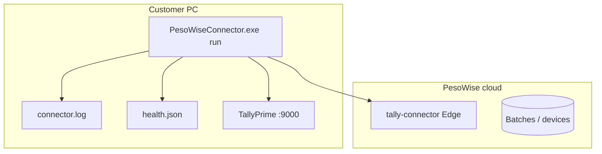

# Phase 4 Report — Production PesoWiseConnector.exe

**Date:** 2026-10-08  
**Goal:** Standalone Windows agent — no npm/dev bridge on customer PCs; logging, health file, reconnect, production CLI guardrails.

---

## 1. Objective

Ship a **pkg-built** `PesoWiseConnector.exe` that:

- Runs **`run`** by default (cloud claim → Tally deliver loop from Phase 3).
- Writes **rotating logs** and **`health.json`** under `%USERPROFILE%\PesoWise\TallyConnector\`.
- **Blocks** dev-only `serve` / `bridge` inside the packaged binary.
- Documents install + scheduled-task registration for logon startup (tray deferred to Phase 7).

---

## 2. Architecture

**Unchanged from Phase 3:** batch delivery uses `deliverClaimedBatch` in `serviceLoop.ts`.

---

## 3. Files modified / added

| File | Change |
|------|--------|
| `connector/tally/src/runtime.ts` | `isPackagedExecutable()`, `isProductionConnectorRuntime()` |
| `connector/tally/src/healthState.ts` | Write `health.json` snapshot |
| `connector/tally/src/logger.ts` | Rotation, redaction, `logError`, global error handlers, `logFilePath()` |
| `connector/tally/src/serviceLoop.ts` | `publishHealth()` after Tally check / delivery |
| `connector/tally/src/main.ts` | Error handlers, `version`, block bridge when packaged, default `run` |
| `connector/tally/src/doctor.ts` | `AGENT_VERSION` → `0.4.0-production` |
| `connector/tally/scripts/build-win-exe.mjs` | Primary output **`PesoWiseConnector.exe`**, aliases, `BUILD_INFO.txt` |
| `connector/tally/scripts/install-connector-production.ps1` | **New** — scheduled task `PesoWiseConnector` |
| `connector/tally/scripts/install-startup.ps1` | Delegates to production installer |
| `connector/tally/README-PRODUCTION.md` | **New** — customer/dev quick reference |
| `connector/tally/src/__tests__/runtime.test.ts` | Production flag unit test |
| `src/components/ServerReportExportPanel.tsx` | Bridge-offline copy mentions installed connector |
| `docs/06-connector-exe.md` | Filled (was placeholder) |

---

## 4. Database / API changes

**None.**

---

## 5. Build & validation checklist

| Step | Command / action | Expected |
|------|------------------|----------|
| TypeScript build | `cd connector/tally && npm.cmd run build` | `dist/main.js` updated |
| Package EXE | `npm.cmd run package:win` | `dist/PesoWiseConnector.exe` exists |
| Version | `PesoWiseConnector.exe version` | JSON `product`, `version`, `packaged: true` |
| Dev bridge blocked | `PesoWiseConnector.exe serve` (packaged) | Exit 2, message to use `run` |
| Pair + run | Pair then `run` with Tally on :9000 | Heartbeat in logs; batches claim when queued |
| Health file | After run | `%USERPROFILE%\PesoWise\TallyConnector\health.json` updates |
| Scheduled task | `install-connector-production.ps1` | Task **PesoWiseConnector** at logon |
| UI | Sync with bridge offline | Message references **PesoWiseConnector.exe** |

---

## 6. Customer vs developer workflow

| Role | Action |
|------|--------|
| **Developer** | `npm.cmd run dev` — Vite + local bridge for UI nudge (unchanged) |
| **Customer** | Install EXE → pair once → `run` or scheduled task; browser may close after Sync starts |

---

## 7. Known limitations (later phases)

| Item | Phase |
|------|-------|
| Pairing wizard in web / Setup | 5 |
| Explicit “sync survives browser close” UX + job polling semantics | 6 |
| System tray, richer startup UX | 7 |
| Health dashboard reading connector state | 8 |
| Single **Setup.exe** (TDL + agent) | 9 |

---

## 8. Ops notes (MicroLink test org)

After Phase 4 on a test PC:

1. Build or copy `PesoWiseConnector.exe`.
2. Pair against `https://pesowise-backup-supabase.unimisk.com` with org pairing code.
3. Ensure Tally company **PesoWise Integration Test** on HTTP **9000** + **Load.tdl**.
4. For job `7b6ae66e-…` (waiting_for_connector): run connector — batches should claim without `npm run dev`.

E2E report rows (Daily Project) still depend on Phase 3 re-deliver + UDF refresh after duplicate-only history.

---

## 9. Sign-off

Phase 4 deliverables: **production EXE packaging**, **logging/health**, **startup script**, **docs**, **UI hint**. Ready to proceed to **Phase 5 (pairing UX)** when approved.
