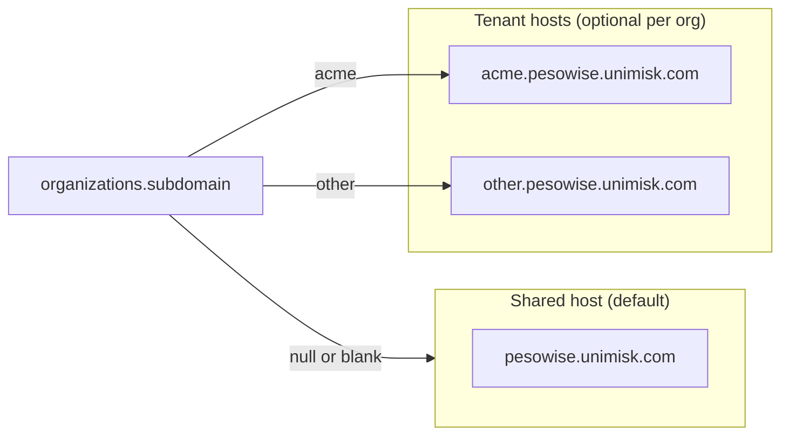

# Tenant subdomains and shared (generic) hosting

> **Step-by-step runbook:** For a single checklist (DNS, env, Supabase, DB, verification), see [TENANT_SUBDOMAIN_SETUP_CHECKLIST.md](./TENANT_SUBDOMAIN_SETUP_CHECKLIST.md).  
> **Interactive help:** Copy the prompt from [TENANT_SUBDOMAIN_GPT_PROMPT.md](./TENANT_SUBDOMAIN_GPT_PROMPT.md) into ChatGPT to be guided step-by-step.

This document describes how **optional per-organization tenant URLs** work alongside the **default shared apex** host. Only organizations that need a dedicated label use `{subdomain}.{base domain}`; everyone else stays on the apex.

Related code:

- `src/lib/tenantContext.ts` — derives tenant label from hostname vs `VITE_APP_BASE_DOMAIN`
- `api/manifest.ts` — dynamic Web App Manifest (org name/logo on tenant hosts; `start_url` `/auth`)
- `src/components/PwaHead.tsx`, `PwaInstallBanner.tsx` — install prompt and meta tags
- `src/contexts/AuthContext.tsx` — loads org context on tenant hosts via `get_organization_by_subdomain`
- `get_employee_auth_email` RPC — employee ID → auth email (no Edge Function; optional browser cache in `src/lib/employeeLoginCache.ts`)
- Migrations `20260513120000` … `20260513120400` — `strategies`, `organizations.subdomain` / `strategy_slug`, `organization_features`, `profiles.employee_id`, RPCs

---

## Two modes at a glance

| Mode | Example URL | Database |
|------|----------------|----------|
| **Shared (generic)** | `https://pesowise.unimisk.com` | `organizations.subdomain` is **null** or blank |
| **Dedicated tenant** | `https://acme.pesowise.unimisk.com` | `organizations.subdomain` = `acme` (single label, no dots) |

The browser **hostname** decides whether the app treats the session as a **tenant host**. If the user opens the apex, it is **not** a tenant host, regardless of which org they belong to.

---

## Mental model



---

## Platform vs per-organization

| Layer | Applies to | Notes |
|-------|------------|--------|
| Wildcard DNS `*.{apex}` | Whole product | Needed if **any** org uses tenant URLs. Apex still works without tenants. |
| `VITE_APP_BASE_DOMAIN` | Whole product | Apex only, e.g. `pesowise.unimisk.com` (no `https://`). |
| `organizations.subdomain` | Per org | **Empty** = generic; **set** = that org’s tenant label. |
| `TENANT_BASE_DOMAIN` (Edge Function secret) | Whole product | Should match the same apex as the SPA. |
| Supabase Auth redirect URLs | Whole product | Include apex + wildcard for `*.{apex}` if you use tenant URLs. |

---

## Phase A — One-time platform setup

1. **Choose the apex hostname**  
   Example: `pesowise.unimisk.com`. This is the URL for all “non-tenant” traffic.

2. **DNS**  
   - Point `pesowise.unimisk.com` to your hosting (as today).  
   - Point `*.pesowise.unimisk.com` to the **same** target so `{label}.pesowise.unimisk.com` serves the same SPA.

3. **TLS**  
   Ensure HTTPS works for the apex and wildcard (typical on Vercel / Cloudflare when DNS is correct).

4. **Frontend environment (production build)**  

   ```env
   VITE_APP_BASE_DOMAIN=pesowise.unimisk.com
   ```

5. **Supabase — Authentication → URL configuration**  
   Keep existing Site URL / redirect URLs for the apex. Add a wildcard pattern for tenant origins if supported in your project, for example:  
   `https://*.pesowise.unimisk.com/**`  
   so email magic links and OAuth redirects work on tenant hosts.

6. **Database**  
   On the correct Supabase project, apply migrations `20260513120000` through `20260513120400` in order. After that, `subdomain` remains **optional** per organization.

7. **Employee ID login RPC**  
   Apply migration `20260515120000_employee_auth_email_rpc.sql`. No Edge Function required. The app caches resolved emails in the browser for 7 days (same device) to avoid repeat lookups.

8. **PostgREST schema cache**  
   After migrations: Supabase Dashboard → **Settings → API → Reload schema** if REST still returns stale errors.

---

## Phase B — Per-organization configuration (Master Admin)

### Default: generic (most orgs)

1. Leave **Tenant subdomain** empty, or clear it.  
2. Users use **`https://pesowise.unimisk.com`** (or your real apex).  
3. No customer-specific URL to communicate.

### Optional: dedicated tenant (selected orgs)

1. Pick a **unique** single-label subdomain (e.g. `acme`).  
2. In Master Admin, set **Tenant subdomain** to that value.  
3. Share **`https://acme.pesowise.unimisk.com`** with that customer.  
4. Configure **strategy** and **organization feature** toggles for that org as needed (e.g. employee ID login on tenant host only).

Uniqueness is enforced in the database (normalized subdomain when present).

---

## Phase C — What end users should do

| Scenario | Where to open the app |
|----------|------------------------|
| Org without tenant subdomain | Apex only |
| Org with tenant subdomain | Prefer `https://{label}.{apex}` for tenant-only flows (e.g. employee ID login when enabled) |
| Wrong tenant label in URL | Resolution fails until they use the correct label or the apex |

---

## Example: MS org (`ms.pesowise.unimisk.com`)

| Item | Value |
|------|--------|
| Organization ID | `e0e9c7a9-555f-448a-8ba2-10fae8e0bf64` |
| Subdomain label | `ms` (not the full hostname) |
| Full tenant URL | `https://ms.pesowise.unimisk.com` |

Run `scripts/setup-tenant-ms.sql` in Supabase SQL Editor, or set subdomain `ms` and enable **Employee ID login** in Master Admin.

Apply migration `20260515120000_employee_auth_email_rpc.sql` on Supabase (SQL Editor). Redeploy the frontend on Vercel.

---

## Phase D — Quick verification

1. **Generic org** — Subdomain blank → open apex → sign in → app works.  
2. **Tenant org** — Subdomain set → open `https://{label}.{apex}` → org resolves via `get_organization_by_subdomain`.  
3. **Employee ID path** — Requires tenant host + org feature + `profiles.employee_id` where applicable; see `src/lib/organizationFeatureKeys.ts`.

---

## Local development

Use a dev-only override so you do not need real DNS on localhost:

```env
VITE_DEV_TENANT_SUBDOMAIN=acme
```

See `.env.example` for all tenant-related variables.

---

## User creation and related environment

| Need | Configuration |
|------|-----------------|
| Normal email users | Valid email, Supabase Auth settings (e.g. email confirmation), redirect URLs covering where users land. |
| Synthetic emails (`user_email_auto` feature) | `VITE_SYNTHETIC_EMAIL_DOMAIN` set to a domain you control (`src/lib/syntheticEmail.ts`). |
| Employee ID login | Org feature `employee_id_login`, tenant subdomain set, `profiles.employee_id`, migrations + `get_employee_auth_email` RPC deployed. |
| Account-created / contact emails | Resend and Edge Function secrets as described in `docs/resend-email-notifications.md`. |

---

## Rollback on the wrong database

If tenant migrations were applied to the wrong Supabase project, use the rollback script documented in your team runbook (drop RPCs → `organization_features` → org FK/columns → `profiles.employee_id` → `strategies`), then optionally clean `supabase_migrations.schema_migrations` and reload the API schema.
